---
tags:
  - rust
  - memory
  - ownership
created: 2026-10-16T12:20:16
updated: 2026-10-21T13:55:04
permalink: /Dev/rust/rust-single-thread-smart-pointers-rc-and-refcell
description: "Rust의 기본 타입부터 Rc·RefCell과 두 타입의 조합까지 메모리 구조를 통해 살펴보며, 공유 소유권과 내부 가변성의 역할 및 메서드에 따른 상태 변화를 설명한다."
---

> [!abstract]+ TL;DR
> - 기본 타입의 저장 구조에서 이어지는 Rc·RefCell의 메모리 관계
> - 공유 소유권을 관리하는 Rc와 내부 값 접근을 관리하는 RefCell의 구분
> - Rc·RefCell 조합과 메서드 호출에 따른 할당·참조 수·borrow 상태 변화

> *AI-assisted*

---

### 1. 기본 타입의 메모리 구조

Rust에서는 ownership과 borrowing 규칙으로 값의 수명과 접근을 관리한다. `&T`·`&mut T`로 값을 빌려도 소유권은 넘어오지 않으므로 참조를 사용하는 동안에는 원본 값을 유지할 소유자가 필요하다.

여러 곳이 같은 값을 각자 필요한 동안 유지해야 한다면 _공유 소유권_이 필요하다. `Rc` 같은 [스마트 포인터](https://doc.rust-kr.org/ch15-00-smart-pointers.html)는 참조 수를 추적해 마지막 소유자가 놓을 때까지 값을 유지한다. 공유 참조로 내부 값을 수정해야 한다면 `RefCell`로 읽기·쓰기 접근을 관리한다.

이 글에서는 single thread의 `Rc`·`RefCell`과 두 타입의 조합을 메모리 구조와 함께 살펴본다. 변수에 담긴 값과 그 값이 소유하거나 빌린 메모리를 구분하면 `clone`·`borrow`가 무엇을 바꾸는지 이해하기 쉽다. 먼저 정수·배열·struct와 `String`·`Vec`·`Box`의 저장 구조부터 확인한다.

> [!note]+ 도식의 기준: 저장 공간과 화살표의 의미
> - **Local variable**: 함수 안의 값은 도식에서 stack에 둔다. 실제 compiler는 register를 사용하거나 저장을 생략할 수 있다.
> - **inline storage**[^inline-storage]: 원소나 필드가 바깥 값의 공간 안에 포함된다. 바깥 값이 heap에 있으면 그 필드도 그 안에 있다.
> - **주소 관계**: 화살표는 포인터나 참조가 가리키는 대상을 나타낸다. 소유·borrow·Weak는 라벨로 구분한다.
> - **상태 변화**: `clone`, `drop`, guard 생성·반납 전후의 단계 그림은 시간 순서다. 단계 박스마다 새 할당이 생긴다는 뜻으로 읽지 않는다.
>
> 도식은 [Rust 타입 배치](https://doc.rust-lang.org/reference/type-layout.html)의 필드 순서·padding·주소를 재현하는 그림이 아니다. Rc는 strong count를 중심으로 표시하고 weak count의 내부 표현은 생략한다. String·Vec 예제는 비어 있지 않은 버퍼를 사용한다.

실행 예제는 각각 독립된 `main` 프로그램이다. 예제의 도식은 코드 주석이나 본문에서 지정한 시점의 상태를 나타낸다.

#### 1.1 Stack의 값과 참조

정수·배열·struct는 자신의 공간 안에 값을 담는다. 참조는 기존 값에 접근할 주소를 담고 slice 참조는 시작 포인터와 길이를 함께 담는다.

```rust
struct Point {
    x: i32,
    y: i32,
}

fn main() {
    let number: i32 = 10;
    let array = [10, 20, 30];
    let point = Point { x: 10, y: 20 };
    let read: &i32 = &number;
    let part: &[i32] = &array[1..];
    // 도식 시점: 다섯 변수가 모두 선언된 뒤

    assert_eq!(*read, 10);
    assert_eq!(part, &[20, 30]);
    assert_eq!(point.x + point.y, 30);
}
```

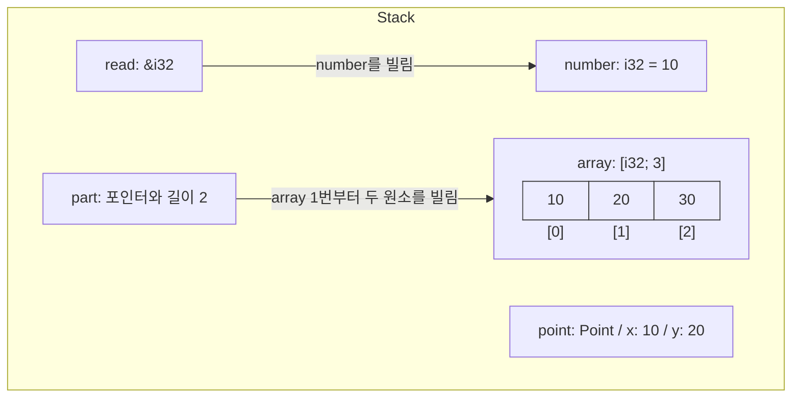

- 배열의 세 원소는 연속해서 놓인다. `point`의 두 필드도 `point` 자신의 공간 안에 포함된다.
- `read`와 `part`는 기존 값을 빌린다. 이 코드에는 별도 heap 할당이 없다.
- `&mut i32`도 기존 숫자를 가리키지만 그 숫자를 수정할 수 있다. 참조를 만드는 것만으로 숫자의 복사본이나 heap 할당이 생기지는 않는다.

#### 1.2 Stack의 포인터와 Heap의 데이터

[`String`](https://doc.rust-lang.org/std/string/struct.String.html#representation)과 [`Vec<T>`](https://doc.rust-lang.org/std/vec/struct.Vec.html#guarantees)는 포인터·길이·capacity를 담는 관리 값이다. 문자열 바이트와 Vec 원소는 별도 heap 버퍼에 있다. [`Box<T>`](https://doc.rust-lang.org/std/boxed/index.html#memory-layout)는 heap에 둔 `T`를 소유하는 포인터다.

```rust
fn main() {
    let text = String::from("hi");
    let values = vec![10, 20, 30];
    let boxed = Box::new(10);
    let text_view: &str = text.as_str();
    let values_view: &[i32] = values.as_slice();
    // 도식 시점: 다섯 변수가 모두 선언된 뒤

    assert_eq!(text_view, "hi");
    assert_eq!(values_view, &[10, 20, 30]);
    assert_eq!(*boxed, 10);
}
```

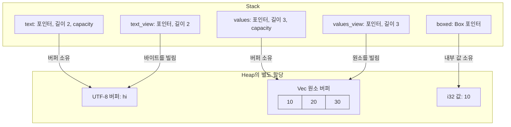

- `text_view`·`values_view`는 heap 버퍼를 빌린다. String·Vec 관리 값 자체를 가리키는 `&String`·`&Vec<i32>`와 대상이 다르다.
- `push_str`·`push`는 버퍼를 수정하고 capacity가 부족하면 재할당할 수 있다. 기존 slice를 이후에도 사용한다면 그 사이에 Vec를 가변 borrow하는 `push`를 호출할 수 없다.
- `Box<String>`이면 String 관리 값이 Box의 heap 할당 안에 들어가고 문자열 버퍼는 별도 할당으로 남는다. 관리 값의 위치와 버퍼의 위치를 나누어 읽는다.

> [!note]+ Deref coercion: 기대하는 참조 타입으로의 자동 변환
> `&i32`가 필요한 자리에서는 `&Box<i32>`를 내부 값의 `&i32`로 자동 변환할 수 있다. 이 기능이 [deref coercion](https://doc.rust-lang.org/std/ops/trait.Deref.html#deref-coercion)이다.
>
> ```rust
> fn main() {
>     let boxed = Box::new(10);
>     let borrowed: &i32 = &*boxed; // 내부 값을 명시적으로 빌림 (clippy warning: explicit_auto_deref)
>     let borrowed2: &i32 = &boxed; // 기대 타입이 &i32이므로 자동 변환
>
>     println!("{borrowed}");  // 10
>     println!("{borrowed2}"); // 10
> }
> ```
>
> 두 참조는 heap에 있는 같은 `i32`를 빌린다. `&i32`라는 기대 타입이 있는 위 예제에서 `&*boxed`를 쓰면 Clippy의 `explicit_auto_deref` 경고가 발생할 수 있다. 타입 주석 없이 `let borrowed2 = &boxed;`로 쓰면 `borrowed2`는 `&Box<i32>`로 추론된다.

| 표현                  | 기존 값과 변수의 변화                     |
| ------------------- | -------------------------------- |
| `let b = a`         | 기본적으로 소유권 이동. `Copy` 타입이면 값 복사   |
| `let b = &a`        | 기존 값을 빌리는 참조 생성, 소유권 유지          |
| `let b = a.clone()` | 타입의 Clone 구현 실행. 복제 대상은 타입마다 다름  |
| `let b = *boxed`    | 내부 타입이 `Copy`이면 값 복사. `i32`가 그 예 |

[`Copy`](https://doc.rust-lang.org/std/marker/trait.Copy.html)는 값의 비트 복사를 허용하는 trait다. `clone`은 String에서는 별도 버퍼를 복제하고 Rc에서는 같은 할당을 가리키는 소유자를 추가한다.

#### 1.3 Smart Pointer의 필요성

같은 값을 여러 곳에서 사용할 때는 해결하려는 문제에 따라 필요한 타입이 달라진다.

- **공유 소유권이 필요한 경우**: `Rc<T>`로 여러 사용자가 같은 값을 각자 필요한 동안 소유한다. 마지막 소유자가 놓을 때까지 값이 유지된다.
- **공유 참조로 수정해야 하는 경우**: `RefCell<T>`는 `&RefCell<T>`로도 내부 값을 수정할 수 있게 한다. 내부 값을 빌릴 때 borrow 규칙을 runtime에 검사한다.

두 타입은 독립적으로 사용할 수 있다. 2·3절에서 각 타입을 살펴보고, 두 요구가 함께 필요한 경우의 `Rc<RefCell<T>>`는 4절에서 다룬다.

---

### 2. `Rc`: A single-threaded reference-counting pointer

게임의 전투 기능과 회복 기능이 같은 `Player`를 보관한다고 하자.   
두 기능은 서로 다른 시점에 등록·해제되며 전투 기능이 종료된 뒤에도 회복 기능이 남아 있다면 같은 Player를 계속 사용할 수 있어야 한다.

Player의 복사본을 각각 보관하면 두 기능이 서로 다른 상태를 다루게 된다.   
아래 예시와 같이 전투 기능이 Player를 소유하고 회복 기능이 `&Player`를 빌리면 참조를 사용하는 동안 Player를 먼저 drop할 수 없다.

```rust
struct Player {
    hp: i32,
}

fn main() {
    let combat = Player { hp: 100 };
    let healing: &Player = &combat;

    drop(combat); // 컴파일 오류[E0505]: 이후에도 사용할 참조의 대상을 drop하려 함
    assert_eq!(healing.hp, 100);
}
```

이런 경우에 각 기능이 [`Rc<Player>`](https://doc.rust-lang.org/std/rc/index.html)를 보유하면 한쪽이 종료되어도 남은 Rc가 같은 Player를 유지한다.

> The type `Rc<T>` provides shared ownership of a value of type `T`, allocated in the heap.

```rust
use std::rc::Rc;

struct Player {
    hp: i32,
}

fn main() {
    let combat = Rc::new(Player { hp: 100 });
    let healing = Rc::clone(&combat); // Player를 복제하지 않고 같은 값의 소유자 추가

    assert!(Rc::ptr_eq(&combat, &healing)); // 같은 heap 할당
    assert_eq!(Rc::strong_count(&combat), 2);

    drop(combat); // strong: 2 → 1. healing이 있으므로 Player는 유지됨
    assert_eq!(healing.hp, 100); // 전투 기능이 종료된 뒤에도 접근 가능
    assert_eq!(Rc::strong_count(&healing), 1);

    drop(healing); // 마지막 Rc가 drop되며 Player도 정리됨
}
```

#### 2.1 주요 method

[Rc API](https://doc.rust-lang.org/std/rc/struct.Rc.html)의 반환 값과 상태 변화를 함께 읽으면 메서드의 역할을 구분할 수 있다.

| 표현                     | 반환 값             | 할당과 상태의 변화                   |
| ---------------------- | ---------------- | ---------------------------- |
| `Rc::new(value)`       | `Rc<T>`          | 카운터와 T를 담는 공유 heap 할당 생성     |
| `Rc::clone(&a)`        | `Rc<T>`          | 같은 할당의 소유자 추가, strong 증가     |
| `Rc::strong_count(&a)` | `usize`          | 현재 strong count 조회           |
| `Rc::ptr_eq(&a, &b)`   | `bool`           | 같은 공유 할당인지 비교                |
| `Rc::downgrade(&a)`    | `Weak<T>`        | Weak 추가, strong 유지           |
| `weak.upgrade()`       | `Option<Rc<T>>`  | 성공 시 소유자 추가, 값이 없으면 None     |
| `Rc::get_mut(&mut a)`  | `Option<&mut T>` | 다른 Rc·Weak가 없으면 내부 값 수정 허용   |
| `Rc::make_mut(&mut a)` | `&mut T`         | 공유 상태에 따라 내부 값 복제 또는 Weak 분리 |
| `drop(a)`              | `()`             | strong 감소, 마지막이면 내부 값 drop   |

> [!note]+ RAII: 객체의 drop에 연결되는 정리
> 자원의 관리를 객체의 수명에 연결하고 drop될 때 정리하도록 하는 방식이 [RAII](https://doc.rust-lang.org/rust-by-example/scope/raii.html)다. scope 종료에 따른 자동 drop과 `drop(value)`를 통한 명시적 drop은 모두 그 타입의 정리 동작을 실행한다.
> - **`Box<T>`**: 내부 T를 drop하고 자신이 소유한 heap 메모리를 해제한다.
> - **`Rc<T>`**: strong count를 줄이고 마지막 Rc이면 내부 T를 drop한다.

#### 2.2 생성 함수와 독립적인 데이터 수명

앞 예시에서는 전투 기능의 Rc를 drop해도 회복 기능의 Rc가 Player를 유지했다. 값을 만든 함수가 끝나도 다른 Rc가 남아 있으면 같은 값이 유지된다.   
여러 부분이 데이터를 함께 사용하고 마지막까지 사용할 부분을 컴파일 시점에 알 수 없는 경우 Rc로 소유권을 공유할 수 있다.

> “…we can’t determine at compile time which part will finish using the data last.” ([The Rust Programming Language](https://doc.rust-lang.org/book/ch15-04-rc.html))

Rc는 공유 값과 카운터를 특정 Rc 변수의 저장 공간과 분리된 _heap 할당_에 둔다.   
각 Rc가 이 할당을 가리키므로 처음 만든 Rc가 drop되거나 생성 함수가 끝난 뒤에도 다른 Rc가 같은 값을 계속 소유할 수 있다.

```rust
use std::rc::Rc;

fn create() -> Rc<i32> {
    let a = Rc::new(10);
    let b = Rc::clone(&a);
    // 첫 번째 도식 시점: a와 b가 같은 값을 소유한다.
    b // Rc 값을 반환값으로 이동
} // a는 drop되어 strong count가 2에서 1로 감소

fn main() {
    let retained = create();
    // 두 번째 도식 시점: create는 끝났지만 공유 값은 유지된다.
    assert_eq!(Rc::strong_count(&retained), 1);
    assert_eq!(*retained, 10);
}
```

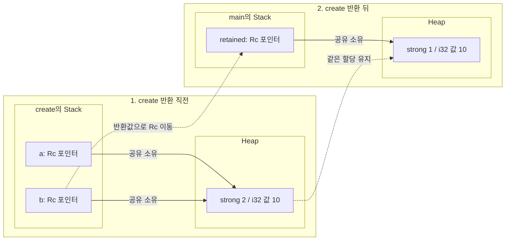

- **함수 반환**: `b`의 Rc 값은 반환값을 거쳐 `retained`로 이동한다. 이 이동은 소유자 수를 바꾸지 않고 `a`의 drop만 strong count를 `2`에서 `1`로 줄인다.
- **저장 공간**: `create`의 stack frame이 끝나도 같은 heap 할당은 유지된다. `retained`가 가리키는 숫자는 생성 때의 `10`이다.

> [!note]+ Rc의 borrow와 clone
> - `&a`는 Rc 변수 `a` 자체를 빌리는 `&Rc<T>`다. strong count를 늘리지 않으며 이 참조를 사용하는 동안에는 `a`가 유효해야 한다.
> - `Rc::clone(&a)`는 같은 heap 할당의 소유자를 추가해 strong count를 늘린다. 새 Rc는 `a`가 drop된 뒤에도 내부 값을 유지할 수 있다.

#### 2.3 T의 종류와 공유 할당

[`Rc::new(value)`](https://doc.rust-lang.org/src/alloc/rc.rs.html#423)는 strong·weak count와 `value`를 함께 담는 heap 할당을 만든다. 카운터는 각각 `Cell<usize>` 필드이고 `value`는 `T` 필드로 내부 구조에 포함된다. 이 내부 구조를 `Box::new`로 할당하므로 `T`가 정수든 String이든 Rc의 heap 할당이 생긴다.

```rust title="Rc"
use std::rc::Rc;

fn main() {
    let number = Rc::new(10);
    let text = Rc::new(String::from("hi"));
    let values = Rc::new(vec![10, 20, 30]);
    // 도식 시점: Rc 세 개를 만든 뒤

    assert_eq!(*number, 10);
    assert_eq!(text.as_str(), "hi");
    assert_eq!(values.as_slice(), &[10, 20, 30]);
}
```

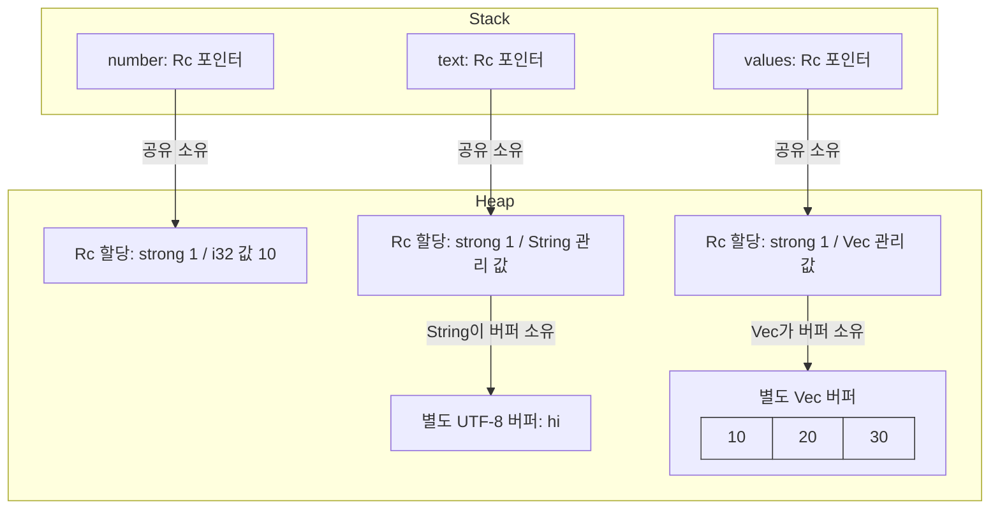

- **`Rc<i32>`**: 숫자도 Rc의 heap 할당 안에 있다. local variable `number`에는 그 할당을 가리키는 Rc 값이 있다.
- **`Rc<String>`·`Rc<Vec<i32>>`**: 관리 값이 카운터와 같은 할당에 포함된다. 문자·원소 버퍼는 String·Vec가 소유하는 별도 할당이다.
- **복제 범위**: 기존 String·Vec를 `Rc::new`에 넘기면 관리 값의 소유권이 이동한다. 버퍼 내용을 복사하는 호출은 아니다.

#### 2.4 Weak와 내부 값의 수명

부모가 자식을 Rc로 소유하고 자식도 부모를 Rc로 소유하면 서로의 strong count가 남는다.[^rc-parent-child-cycle] 외부 소유자가 사라져도 이 순환 때문에 내부 값이 정리되지 않을 수 있다. 소유할 필요가 없는 역방향 연결에는 [`Weak<T>`](https://doc.rust-lang.org/std/rc/struct.Weak.html)를 사용할 수 있다.

```rust
use std::rc::Rc;

fn main() {
    let owner = Rc::new(10);
    let weak = Rc::downgrade(&owner); // 반환 타입: Weak<i32>
    let temporary = weak.upgrade().unwrap(); // upgrade(): Option<Rc<i32>>, unwrap() 뒤: Rc<i32>
    assert_eq!(Rc::strong_count(&owner), 2);
    // 도식 시점: 두 Rc 소유자와 Weak가 존재한다.

    drop(owner);
    assert_eq!(*temporary, 10);
    drop(temporary);
    assert!(weak.upgrade().is_none()); // upgrade(): Option<Rc<i32>>, 마지막 Rc가 drop되어 None
    drop(weak);
}
```

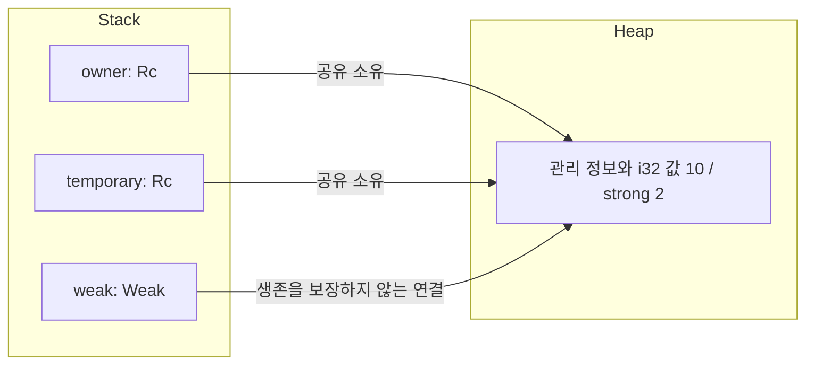

- **`downgrade`**: 원래 Rc를 유지하고 Weak를 추가한다. strong count는 늘리지 않는다.
- **`upgrade`**: 내부 값이 살아 있으면 새 Rc를 담은 `Some`을 반환해 strong count를 늘린다. 기존 Weak는 유지된다.
- **마지막 Rc의 종료**: 내부 `T`가 drop된다. Weak가 남으면 관리 정보를 담은 할당 공간은 유지되지만 `upgrade()`는 `None`이다.
- **마지막 Weak의 종료**: Rc가 이미 모두 사라진 상태라면 남은 할당 공간도 해제된다.

일반 참조 `&T`는 사용하는 동안 대상이 유효하도록 compiler가 검사한다. Weak는 대상의 수명이 끝난 뒤에도 보관할 수 있으며 값을 사용할 때 `upgrade()`의 결과를 확인한다.

#### 2.5 get_mut과 make_mut

Rc로 소유한 값을 수정하는 방식은 공유 상태와 복제 허용 여부에 따라 달라진다. 두 메서드는 모두 변경할 Rc 자체를 `&mut Rc<T>`로 받는다.

- **`get_mut`**: 같은 할당을 가리키는 다른 Rc·Weak가 없으면 `Some(&mut T)`를 반환하고, 있으면 `None`을 반환한다.
- **`make_mut`**: 다른 Rc가 있으면 T를 복제한 새 할당으로 호출자의 Rc를 연결한 뒤 `&mut T`를 반환한다. 다른 Rc·Weak가 없으면 기존 값을 사용한다. 이런 필요 시 복제를 [clone-on-write](https://doc.rust-lang.org/std/rc/struct.Rc.html#method.make_mut)라고 한다.

복제를 허용하는 경우에는 `make_mut`을 바로 호출해도 된다. 아래에서는 두 메서드의 차이를 확인하려고 공유 전후에 `get_mut`의 결과를 검사한다. Player에 붙인 `#[derive(Clone)]`은 `make_mut`이 필요할 때 Player를 복제할 수 있도록 한다.

```rust
use std::rc::Rc;

#[derive(Clone)]
struct Player {
    hp: i32,
}

fn main() {
    let mut combat = Rc::new(Player { hp: 100 });

    Rc::get_mut(&mut combat).unwrap().hp -= 10; // 단독 소유: 기존 Player 수정
    assert_eq!(combat.hp, 90);

    let healing = Rc::clone(&combat); // 같은 Player의 소유자 추가
    assert_eq!(Rc::strong_count(&combat), 2);
    assert!(Rc::get_mut(&mut combat).is_none()); // 공유 중이므로 가변 접근 거부
    // 도식 시점 ①: 두 Rc가 체력 90인 같은 Player를 소유한다.

    Rc::make_mut(&mut combat).hp -= 30; // Player를 복제한 뒤 combat 쪽만 수정
    assert_eq!(combat.hp, 60);
    assert_eq!(healing.hp, 90);
    assert!(!Rc::ptr_eq(&combat, &healing));
    assert_eq!(Rc::strong_count(&combat), 1);
    assert_eq!(Rc::strong_count(&healing), 1);
    // 도식 시점 ②: combat과 healing이 서로 다른 Player를 소유한다.
}
```

시점 ①에서는 단독 소유 중에 체력을 `90`으로 수정한 뒤 두 Rc가 같은 Player를 소유한다.

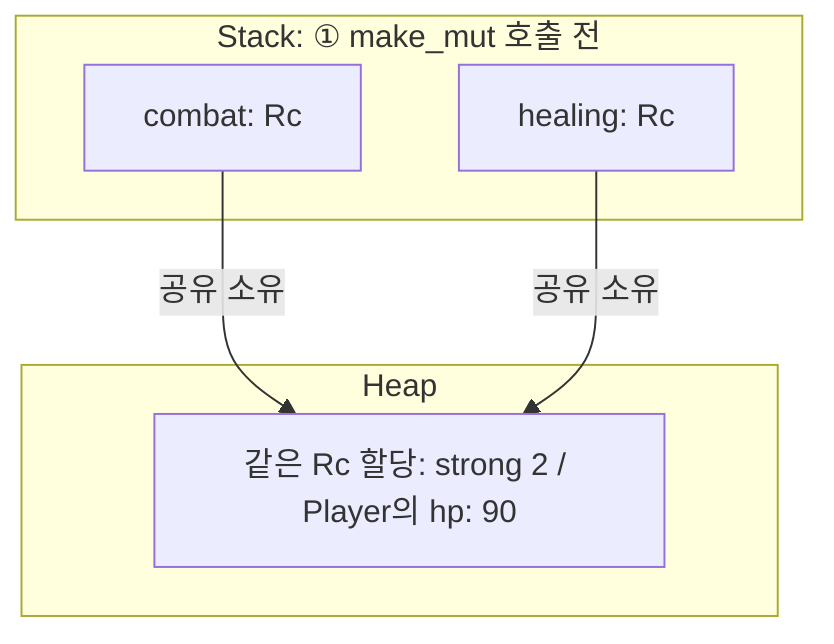

- `combat`·`healing`은 같은 heap 할당을 소유한다. `get_mut`은 다른 Rc가 남아 있어 `None`을 반환한다.

시점 ②에서는 `make_mut`이 Player를 복제하고 `combat`을 새 할당으로 연결한 뒤 체력을 `60`으로 바꾼다.

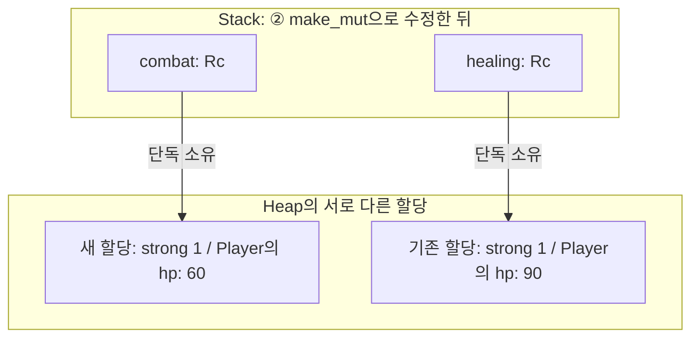

- `healing`은 기존 Player를 계속 소유하므로 체력은 `90`으로 유지된다. 두 기능이 같은 체력의 변경을 공유하는 경우는 4절에서 다룬다.
- T가 String·Vec이면 Clone 구현에 따라 내부 버퍼도 복제된다. Rc의 공유 할당과 그 안의 T가 소유하는 별도 버퍼를 구분한다.

> [!note]+ 다른 Rc 없이 Weak가 있는 경우
> 자기 Rc 외에 Weak만 있으면 `get_mut`은 `None`을 반환한다. `make_mut`은 T를 clone하지 않고 Weak와 값의 연결을 분리하며, 기존 Weak의 `upgrade()`는 `None`이 된다.

---

### 3. `RefCell`: Dynamically checked borrow rules

앞 절의 전투·회복 예시에서 이번에는 Player의 체력 변경을 살펴본다. 전투는 체력을 줄이고 회복은 늘리며 두 기능이 같은 값의 변경을 공유해야 한다. 2.5절의 `make_mut` 예제처럼 Player를 복제해 분리하면 이 요구를 만족하지 못한다.

아래에서는 접근 문제를 살펴보기 위해 하나의 local variable `player`를 두 기능이 빌린다. 두 기능은 참조를 각자 보관해 여러 이벤트에서 재사용한다. 두 참조 `combat`·`healing`을 모두 `&mut Player`로 만들려는 코드는 컴파일되지 않는다.

```rust
struct Player {
    hp: i32,
}

fn main() {
    let mut player = Player { hp: 100 };
    let combat = &mut player;
    let healing = &mut player; // 컴파일 오류: 가변 borrow가 겹침

    combat.hp -= 30;
    healing.hp += 20;
    combat.hp -= 10;
}
```

`healing`을 만든 뒤에도 `combat`을 사용하므로 첫 번째 가변 borrow가 끝나지 않는다. 체력을 바꾸는 문장은 순서대로 실행하더라도 두 가변 참조를 이 형태로 함께 보관할 수 없다.

[`RefCell<T>`](https://doc.rust-lang.org/std/cell/struct.RefCell.html)는 borrow 규칙을 runtime에 검사해 이런 접근을 제공한다.

> A mutable memory location with dynamically checked borrow rules

#### 3.1 guard와 주요 method

RefCell의 주요 method인 `borrow()`·`borrow_mut()`을 호출할 때 현재 borrow와 충돌하는지 검사가 필요하고 이후의 요청도 검사하려면 앞서 허용한 borrow가 언제 반납되는지 runtime에 기록해야 한다. (일반 참조 `&T`·`&mut T` 자체는 사용이 끝날 때 RefCell의 borrow 상태를 갱신하지 않는다)

이를 위해 RefCell은 **값에 접근하는 동안 borrow를 유지하는 guard 객체**를 반환한다. guard가 drop될 때 RefCell의 borrow 상태를 갱신해 접근을 반납한다. 내부 T의 소유권은 계속 RefCell에 남는다.

- **읽기 guard**: [`Ref<'b, T>`](https://doc.rust-lang.org/std/cell/struct.Ref.html). `Deref`로 내부 값을 `&T`로 읽을 수 있다.
- **쓰기 guard**: [`RefMut<'b, T>`](https://doc.rust-lang.org/std/cell/struct.RefMut.html). `Deref`로 읽고 `DerefMut`으로 내부 값을 `&mut T`로 수정할 수 있다.

`T`는 빌리는 내부 값이고 `'b`는 guard가 RefCell을 빌리는 lifetime이다. Player를 빌리는 예제에서는 `Ref<'_, Player>`·`RefMut<'_, Player>`로 표시할 수 있으며 `'_`의 lifetime은 compiler가 추론한다.

> [!note]- 구현: guard가 담는 정보
> 현재 [타입 정의](https://doc.rust-lang.org/src/core/cell.rs.html#1617)에서 주석과 속성을 생략한 모습이다.
>
> ```rust
> pub struct Ref<'b, T: ?Sized + 'b> {
>     value: NonNull<T>,
>     borrow: BorrowRef<'b>,
> }
>
> pub struct RefMut<'b, T: ?Sized + 'b> {
>     value: NonNull<T>,
>     borrow: BorrowRefMut<'b>,
>     marker: PhantomData<&'b mut T>,
> }
> ```
>
> - **`value`**: 내부 T의 주소를 담는 포인터다. guard는 이 포인터로 기존 값에 접근한다.
> - **`borrow`**: RefCell의 borrow 카운터를 참조하는 추적 객체다. guard가 drop되면 이 객체도 drop되면서 읽기 borrow는 카운터를 `1` 줄이고, 일반적인 쓰기 borrow는 `-1`에서 `0`으로 되돌린다.
> - **`marker`**: RefMut의 lifetime과 가변 참조에 관한 타입 정보를 compiler에 전달한다. `PhantomData` 자체는 데이터를 저장하지 않는다.

현재 구현은 [`isize` 카운터](https://doc.rust-lang.org/src/core/cell.rs.html#935)로 borrow 종류와 개수를 함께 기록한다. 
- `0`은 빌림 없음
- 양수 `n`은 읽기 guard `n`개
- 음수는 쓰기 borrow 유지 중임을 의미 (일반적인 `borrow_mut()` 직후의 값은 `-1`)

아래 표는 메서드 호출에 따른 borrow 상태와 값의 변화를 보여준다.

| 메서드 원형                                                                  | 상태와 값의 변화                          | Borrow 충돌 검사와 접근 조건            |
| ----------------------------------------------------------------------- | ---------------------------------- | ------------------------------ |
| `pub const fn new(value: T) -> RefCell<T>`                              | 내부 값과 카운터 `0` 생성                   | 새 RefCell 생성                   |
| `pub fn borrow(&self) -> Ref<'_, T>`                                    | 읽기 성공 시 `n → n + 1`                | 쓰기 중인 `n < 0`이면 panic          |
| `pub fn borrow_mut(&self) -> RefMut<'_, T>`                             | 쓰기 성공 시 `0 → -1`                   | 다른 borrow가 있는 `n != 0`이면 panic |
| `pub fn try_borrow(&self) -> Result<Ref<'_, T>, BorrowError>`           | 읽기 성공 시 `n → n + 1`                | `n < 0`이면 `Err`                |
| `pub fn try_borrow_mut(&self) -> Result<RefMut<'_, T>, BorrowMutError>` | 쓰기 성공 시 `0 → -1`                   | `n != 0`이면 `Err`               |
| `pub fn replace(&self, t: T) -> T`                                      | 내부 T 교체·기존 T의 소유권 반환, 호출 뒤 카운터 `0` | 다른 borrow가 있는 `n != 0`이면 panic |
| `pub fn get_mut(&mut self) -> &mut T`                                   | runtime borrow 검사 없이 내부 값 접근       | `&mut self`로 배타 접근 확보          |
| `pub const fn into_inner(self) -> T`                                    | RefCell을 소비하고 T의 소유권 반환            | `self` 소유권 필요                  |

실패한 borrow 요청은 카운터를 바꾸지 않는다. 여러 읽기 borrow를 함께 유지하거나 쓰기 borrow 하나를 유지할 수 있으며 읽기와 쓰기는 겹칠 수 없다.

- **충돌 처리의 선택**
	- `borrow()`·`borrow_mut()`은 충돌을 프로그램 오류로 취급해 panic
	- 실패 시 다른 작업을 하거나 나중에 다시 시도하려면 `try_borrow()`·`try_borrow_mut()`의 `Result`를 `match`나 `if let`으로 처리
- **unwrap의 동작**
	- `borrow()`와 `try_borrow().unwrap()`은 성공하면 같은 종류의 읽기 guard를 얻고 충돌하면 둘 다 panic
		- `borrow()`는 RefCell 내부에서, `try_borrow().unwrap()`은 반환된 `Err`를 `unwrap()`하는 과정에서 panic
	- 쓰기 접근인 `borrow_mut()`와 `try_borrow_mut().unwrap()`도 같은 관계이므로 실패 시 panic을 허용하는 코드에서는 일반 메서드가 간단

`get_mut()`은 compiler가 `&mut RefCell<T>`의 배타 접근을 보장하는 경우다. `into_inner()`는 내부 값을 빌리는 호출과 달리 컨테이너를 소비한다.

> [!note]+ Borrow의 종료 시점: 마지막 사용과 guard의 drop
> 일반 참조 `&T`·`&mut T`는 마지막 사용 이후 compiler의 판단에 의해 borrow가 끝날 수 있다.   
> 하지만 `Ref`·`RefMut` guard는 **마지막 사용과 별개로 drop될 때** borrow를 반납한다.

#### 3.2 Player의 공유 참조와 내부 변경

Player를 RefCell로 감싸면 두 기능은 `&RefCell<Player>`를 보관한다. 각 기능은 체력을 확인할 때 읽기 guard를, 변경할 때 쓰기 guard를 얻는다. 두 기능의 공유 참조는 함께 유지하면서 내부 Player를 빌리는 시점을 나눌 수 있다.

```rust
use std::cell::{Ref, RefCell, RefMut};

struct Player {
    hp: i32,
}

fn main() {
    let player = RefCell::new(Player { hp: 100 });
    let combat: &RefCell<Player> = &player;
    let healing: &RefCell<Player> = &player;

    let combat_view: Ref<'_, Player> = combat.borrow(); // Ref<Player>: 읽기 guard. 0 → 1
    let healing_view: Ref<'_, Player> = healing.borrow(); // Ref<Player>: 읽기 guard 추가. 1 → 2
    assert_eq!(combat_view.hp, 100);
    assert_eq!(healing_view.hp, 100);
    assert!(combat.try_borrow_mut().is_err()); // Err: 읽기 guard 유지 중. 카운터 2 유지

    drop(combat_view); // 2 → 1
    drop(healing_view); // 1 → 0: 마지막 읽기 guard 반납

    {
        let mut writer: RefMut<'_, Player> = combat.borrow_mut(); // RefMut<Player>: 쓰기 guard. 0 → -1
        writer.hp -= 30; // 100 → 70
        assert!(healing.try_borrow().is_err()); // Err: 쓰기 guard 유지 중. 카운터 -1 유지
        // 도식 시점 ①: 전투의 writer가 쓰기 borrow를 유지한다.
    } // writer가 drop되며 쓰기 borrow 반납. -1 → 0

    if let Ok(mut writer) = healing.try_borrow_mut() {
        writer.hp += 20; // 70 → 90. 쓰기 borrow를 얻었을 때만 회복
    } // 성공한 쓰기 borrow를 반납

    combat.borrow_mut().hp -= 10; // 90 → 80. 임시 guard는 문장 끝에서 drop
    assert_eq!(healing.borrow().hp, 80); // 임시 읽기 guard도 문장 끝에서 drop
    // 도식 시점 ②: 모든 guard를 반납하고 두 공유 참조만 남은 뒤
}
```

이 예제에서 `player`는 `let mut` 없이 선언했고 `combat`·`healing`은 공유 참조 `&RefCell<Player>`다. 그 참조로 `borrow_mut()`을 호출해 얻은 `RefMut<Player>` guard를 이용해 Player의 체력을 수정한다. 

> 공유 참조로 접근하는 객체의 내부 상태를 수정하는 성질을 [내부 가변성](https://doc.rust-lang.org/std/cell/index.html)이라 한다.

- **두 기능의 읽기**
	- `combat_view`·`healing_view`는 같은 Player를 읽는 guard로 둘이 유지되는 동안 첫 `try_borrow_mut()`은 `Err`를 반환
	- 두 `drop`을 생략하면 마지막 사용이 끝났어도 읽기 borrow가 남아 뒤의 `combat.borrow_mut()`에서 panic
- **전투 중의 접근**
	- `writer.hp`는 guard의 dereference로 RefCell 안의 Player에 접근
	- 이 쓰기 guard가 유지되는 동안 `healing.try_borrow()`도 `Err`를 반환하며 블록 끝에서 `writer`가 drop된 뒤 다시 읽거나 쓸 수 있음
- **회복과 다음 전투**
	- `if let Ok(...)`는 쓰기 borrow를 얻으면 회복하고 충돌하면 이번 회복을 건너뜀 
	- 마지막 전투처럼 guard를 변수에 담지 않고 `combat.borrow_mut().hp`로 접근하면 이 문장의 임시 guard는 문장 끝에서 drop된다.

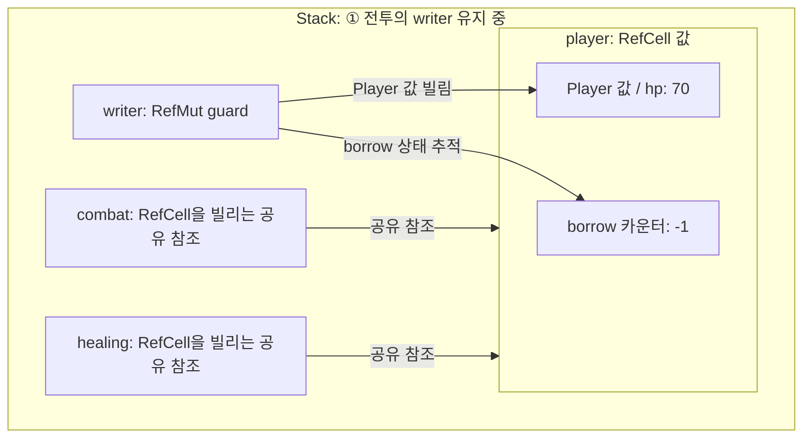

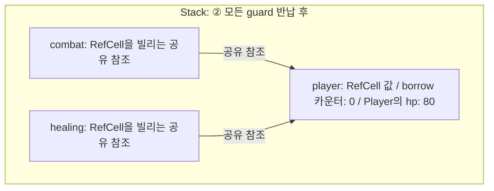

#### 3.3 i32·String·Vec의 메모리 구조

`RefCell<T>`는 borrow 상태와 `UnsafeCell<T>`를 필드로 담는다. `UnsafeCell<T>`는 T를 자신의 저장 공간 안에 담는 wrapper다.   

아래 세 예제는 RefCell을 local variable에 두고 `writer`가 쓰기 borrow를 유지하는 시점의 저장 구조를 비교한다.

##### `RefCell<i32>`

```rust
use std::cell::RefCell;

fn main() {
    let cell = RefCell::new(10);

    {
        let mut writer = cell.borrow_mut();
        *writer += 1;
        // 도식 시점: writer가 쓰기 borrow를 유지한다.
    }

    assert_eq!(*cell.borrow(), 11);
}
```

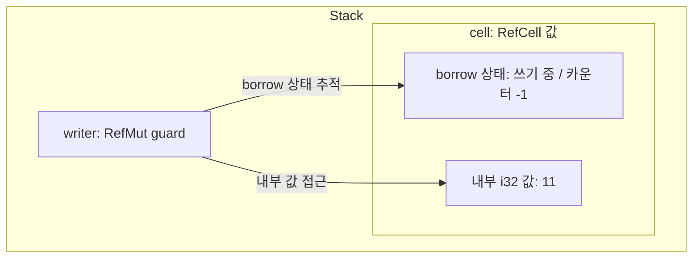

- **i32의 저장 위치**: 상태 정보와 숫자 `11`은 모두 local variable `cell` 안에 있다. `RefCell::new(10)`은 숫자를 heap에 따로 배치하지 않는다.
- **guard의 접근 대상**: `*writer`로 RefCell 안의 `i32`를 수정한다. `writer`는 내부 값을 빌리는 guard이며 숫자의 복사본을 수정하지 않는다.


##### `RefCell<String>`
`RefCell<String>`은 borrow 상태와 String의 포인터·길이·capacity를 함께 담고 `RefCell<Vec<i32>>`는 borrow 상태와 Vec의 포인터·길이·capacity를 함께 담는다. 문자열 바이트와 Vec 원소는 각각 별도 heap 버퍼에 있다.

```rust 
use std::cell::RefCell;

fn main() {
    let text = RefCell::new(String::from("hi"));

    {
        let mut writer = text.borrow_mut();
        writer.push_str(" Rust");
        assert_eq!(writer.as_str(), "hi Rust");
        // 도식 시점: writer가 쓰기 borrow를 유지한다.
    }

    assert_eq!(text.borrow().as_str(), "hi Rust");
}
```

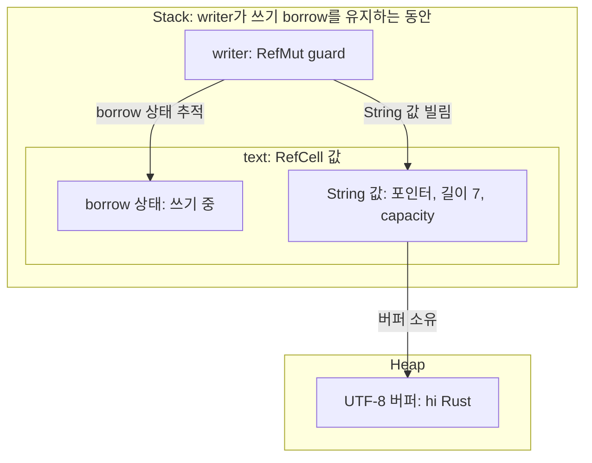

- **String의 저장 위치**: 관리 값은 `text` 안에 포함되고 문자열 바이트 `hi Rust`는 heap 버퍼에 있다. RefCell 안에 String을 담는다고 문자열 버퍼를 새로 복제하지 않는다.
- **guard의 접근 대상**: `writer`는 RefCell 안의 String 값을 빌린다. `writer.push_str(" Rust")`는 그 String이 소유한 버퍼에 문자를 추가한다.

##### `RefCell<Vec<i32>>`

```rust
use std::cell::RefCell;

fn main() {
    let values = RefCell::new(vec![10, 20]);

    {
        let mut writer = values.borrow_mut();
        writer.push(30);
        assert_eq!(writer.as_slice(), &[10, 20, 30]);
        // 도식 시점: writer가 쓰기 borrow를 유지한다.
    }

    assert_eq!(values.borrow().as_slice(), &[10, 20, 30]);
}
```

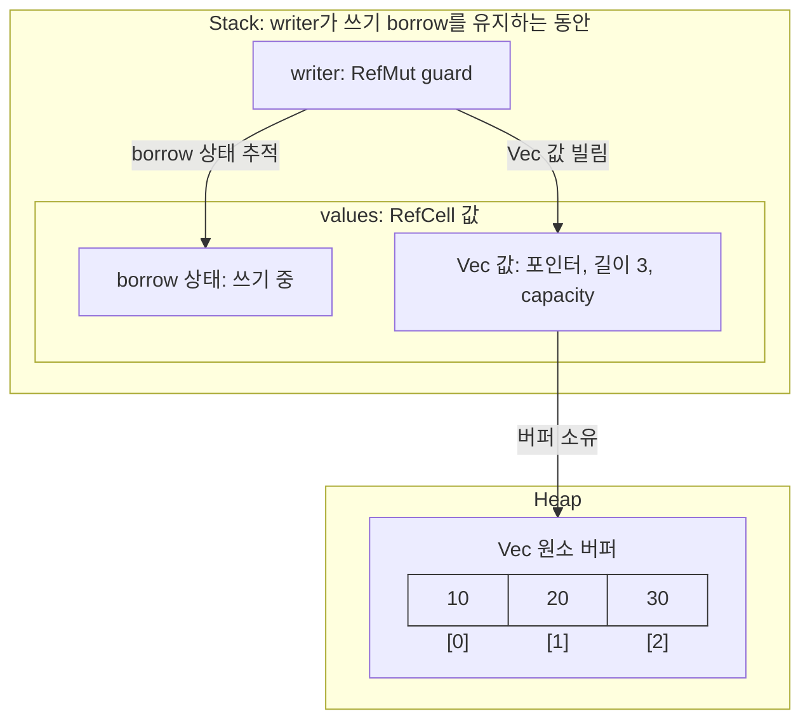

RefCell 자신이 놓이는 위치는 바깥에 담는 방식에 따라 달라진다.   
같은 `RefCell<String>`을 `Box`나 `Rc` 안에 담으면 borrow 상태와 String 관리 값도 그 heap 할당 안에 놓이고 문자열 버퍼는 별도 heap 할당으로 유지된다.

---

### 4. `Rc`와 `RefCell`의 조합

> [!abstract]+ `Rc`와 `RefCell`: 조합과 수정 대상
> - **기본 역할**: `Rc`는 같은 값의 공유 소유권을, `RefCell`은 내부 값을 빌리는 접근을 관리한다.
> - **`Rc<RefCell<T>>`**: 여러 Rc가 같은 RefCell과 그 안의 T를 함께 소유한다. 각 소유자는 guard를 얻어 같은 T를 수정할 수 있다.
> - **`RefCell<Rc<T>>`**: RefCell 안의 Rc를 교체해 가리키는 대상을 바꾼다.

#### 4.1 전투·회복 기능의 플레이어 공유

3.2절의 `combat`·`healing`은 local variable `player`를 `&RefCell<Player>`로 빌렸으므로 두 기능이 참조를 사용하는 동안 `player`를 유지해야 했다.

여기서는 RefCell과 Player를 Rc의 heap 할당 안에 담고 `combat`·`healing`이 각자 `Rc<RefCell<Player>>`를 소유한다. **각 기능이 자기 Rc를 보유하는 동안 같은 값이 유지**되므로 `combat`을 먼저 drop해도 `healing`은 Player를 계속 사용할 수 있다.

시점 ①은 체력을 `100`에서 `70`으로 바꾼 직후이며 쓰기 borrow 중에는 회복 기능의 읽기도 거부된다.

```rust
use std::cell::RefCell;
use std::rc::Rc;

struct Player {
    hp: i32,
}

fn main() {
    let combat = Rc::new(RefCell::new(Player { hp: 100 }));
    let healing = Rc::clone(&combat);

    {
        let mut writer = combat.borrow_mut(); // RefMut<Player>
        writer.hp -= 30;
        assert!(healing.try_borrow().is_err());
        // 도식 시점 ①: strong count는 2이고 writer가 쓰기 borrow를 유지한다.
    }

    healing.borrow_mut().hp += 20;
    combat.borrow_mut().hp -= 10;
    drop(combat);
    // 도식 시점 ②: combat을 drop하고 healing만 남은 뒤

    assert_eq!(healing.borrow().hp, 80);
    assert_eq!(Rc::strong_count(&healing), 1);
}
```

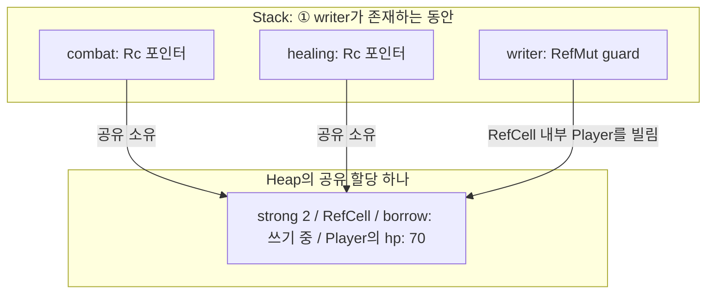

- **공유 대상**: `combat`·`healing`은 같은 RefCell과 그 안의 Player를 소유
- **상태의 구분**: `Rc::clone`·Rc의 drop은 strong count를 바꾸고 guard의 생성·drop은 RefCell의 borrow 상태를 바꿈
- **메서드 탐색**: `combat.borrow_mut()`은 Rc의 dereference로 내부 RefCell에 접근한 뒤 `RefCell::borrow_mut()`을 호출

시점 ①의 공유 할당 안에서 필드가 포함되는 관계는 다음과 같다.

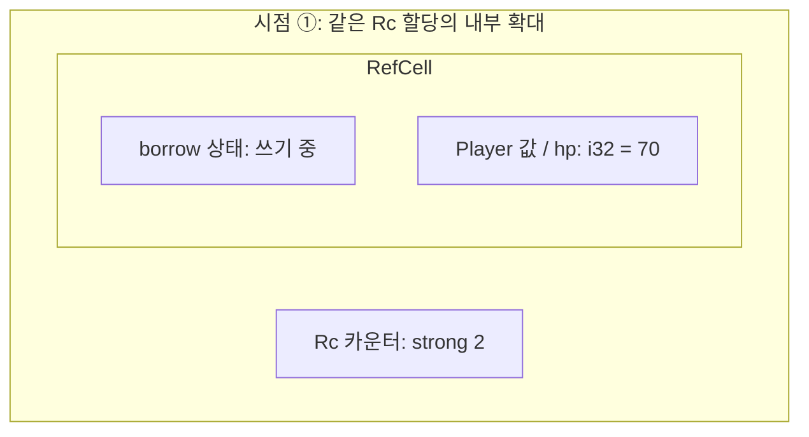

- RefCell과 Player는 Rc의 heap 할당 안에 함께 포함된다. wrapper를 하나 더 감쌌다는 이유로 heap 할당이 하나 더 생기지는 않는다.
- `writer`가 drop되면 다시 읽거나 수정할 수 있다. 이후 회복과 전투를 거쳐 체력은 `80`이 되고 `combat`을 drop한 뒤에도 `healing`이 그 값을 소유한다.

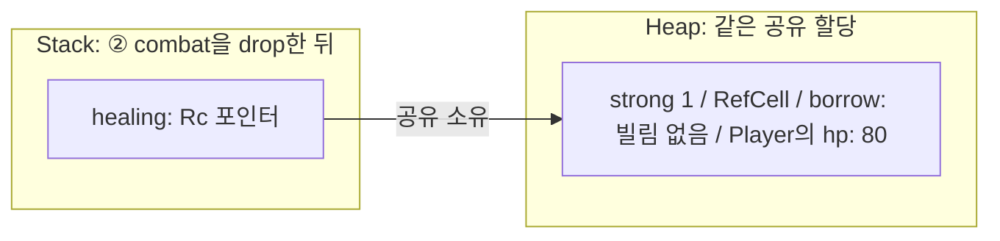

#### 4.2 wrapper 순서와 수정 대상

`Rc<RefCell<T>>`는 여러 소유자가 같은 T를 수정하는 조합이다. 순서를 바꾼 `RefCell<Rc<T>>`는 내부 Rc를 교체해 공유할 대상을 바꾸는 데 쓸 수 있다.

예를 들어 single thread에서 여러 콜백이 같은 설정 관리 객체를 공유 참조로 사용한다고 하자. 각 작업은 시작할 때 `Rc<Config>`를 복제해 설정 스냅샷을 보관한다. 설정이 갱신되면 이후 작업에는 새 설정을 제공하되 기존 작업은 처음 받은 설정으로 계속 실행해야 한다.

관리 객체의 메서드를 `&self`로 호출하는 구조에서는 일반 Rc 필드에 새 Rc를 대입할 수 없다. 필드를 `RefCell<Rc<Config>>`로 두면 공유 참조로도 현재 설정의 Rc를 교체할 수 있다. 기존 작업이 보유한 Rc는 이전 Config를 계속 유지한다. 작업에 Rc를 복제해 넘긴 뒤에는 RefCell의 읽기 guard를 유지할 필요가 없다.

아래 코드는 **Rc의 교체와 기존 값의 유지**를 `i32`로 단순화한 예제다.

```rust
use std::cell::RefCell;
use std::rc::Rc;

fn main() {
    let original = Rc::new(10);
    let slot: RefCell<Rc<i32>> = RefCell::new(Rc::clone(&original));
    // 도식 시점 ①: original과 slot 안의 Rc가 같은 10을 소유한다.

    let previous: Rc<i32> = slot.replace(Rc::new(20));
    // 도식 시점 ②: slot은 새 20을, original과 previous는 기존 10을 소유한다.

    assert_eq!(**slot.borrow(), 20);
    assert_eq!(*original, 10);
    assert_eq!(*previous, 10);
    assert!(Rc::ptr_eq(&original, &previous));
}
```

시점 ①에서는 `original`과 `slot` 안의 Rc가 같은 heap 할당을 소유한다.

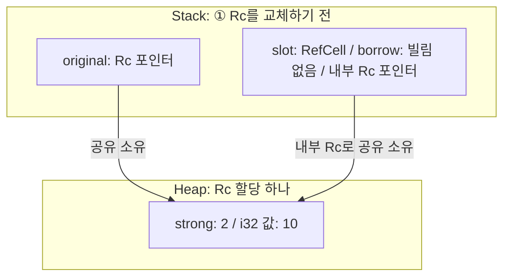

- **저장 위치**: stack의 `slot` 안에는 borrow 상태와 Rc 포인터가 있고 `i32` 값과 카운터는 Rc의 heap 할당에 존재

시점 ②에서는 `slot` 안의 Rc가 새 할당의 `20`을 가리킨다. 기존 Rc는 `previous`로 이동한다.

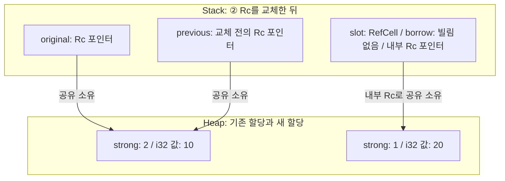

- **교체 대상**
	- [RefCell::replace](https://doc.rust-lang.org/std/cell/struct.RefCell.html#method.replace)는 내부 값을 새 값으로 바꾸고 이전 값을 반환 (여기서는 `Rc<i32>`를 교체했으므로 반환값도 `Rc<i32>`)
	- 내부 값의 borrow가 남아 있으면 panic
- **기존 값의 수명**
	- `10`은 수정되지 않으며 `original`과 `previous`가 계속 소유
	- `slot`의 교체가 다른 Rc의 대상을 함께 바꾸지는 않음

---

### 5. 타입 선택

#### 5.1 소유권과 접근 방식의 비교

| 타입               | 공유 소유권 | 내부 T의 저장 위치         | 내부 값을 수정하는 경로                             | 공유 범위                 |
| ---------------- | ------ | ------------------- | ----------------------------------------- | --------------------- |
| `Rc<T>`          | 제공     | Rc의 공유 heap 할당 안    | get_mut·make_mut 또는 T의 내부 가변성 API         | 같은 thread             |
| `RefCell<T>`     | 제공 안 함 | RefCell 자신의 필드      | borrow_mut·try_borrow_mut의 guard          | 같은 thread에서의 공유 참조 접근 |
| `Rc<RefCell<T>>` | 제공     | Rc 할당 안의 RefCell 필드 | RefCell의 guard                            | 같은 thread             |
| `RefCell<Rc<T>>` | Rc가 제공 | Rc의 공유 heap 할당 안    | guard·replace로 내부 Rc 교체. T 수정은 Rc의 규칙을 따름 | 같은 thread             |
#### 5.2 상황별 조합

| 필요한 동작                           | 선택할 수 있는 타입      |
| -------------------------------- | ---------------- |
| 한 소유자가 값을 수정하고 배타적인 접근도 확보 가능    | 일반 값과 `&mut T`   |
| 같은 thread의 여러 객체가 값의 수명을 함께 유지   | `Rc<T>`          |
| 공유 참조로 접근하면서 실행 중 검사로 내부 값 수정    | `RefCell<T>`     |
| 같은 thread의 여러 소유자가 같은 값 수정       | `Rc<RefCell<T>>` |
| 공유 참조로 현재 Rc를 교체하고 기존 소유자의 값은 유지 | `RefCell<Rc<T>>` |

소유권을 이미 빌려 줄 수 있는 구조라면 `&T`·`&mut T`만으로도 필요한 접근을 표현할 수 있다. 같은 thread 안에서는 공유 소유권이 필요한지와 공유 참조로 내부 값을 수정해야 하는지를 각각 결정하면 wrapper의 역할을 구분할 수 있다. 여러 thread가 같은 값을 사용하는 경우의 [[Rust Thread Safe Smart Pointers - Arc and Mutex|Arc와 Mutex]]는 별도 글에서 다룬다.

[^inline-storage]: 메모리 배치를 설명할 때 쓰는 표현이다. [SmallVec 문서](https://docs.rs/smallvec/latest/smallvec/struct.SmallVec.html)에서도 구조체 내부에 원소를 직접 저장하는 방식을 `inline`으로 표현한다.

[^rc-parent-child-cycle]: 예를 들어 파일 탐색기의 폴더 트리에서 `문서` 노드가 자식 `사진`을 `Rc`로 보유하고 `사진`도 상위 폴더 탐색을 위해 `문서`를 `Rc`로 보유하는 경우다. 이런 [양방향 소유 관계](https://doc.rust-kr.org/ch15-06-reference-cycles.html#자식에서-부모로-가는-참조자-추가하기)에서는 외부 Rc를 모두 drop해도 두 노드가 서로를 소유해 strong count가 각각 `1`로 남는다.
