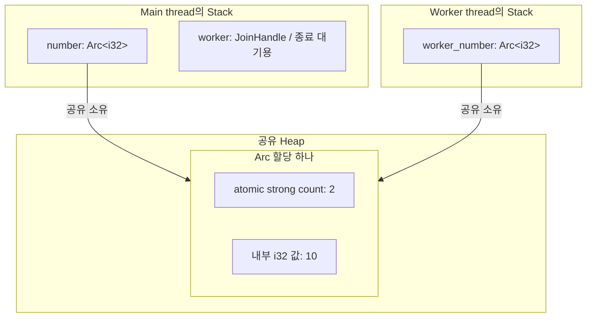
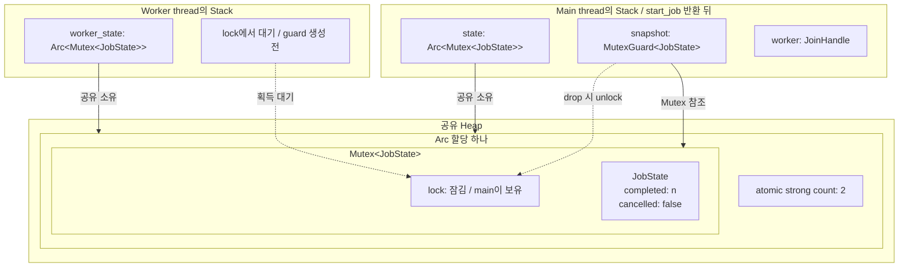
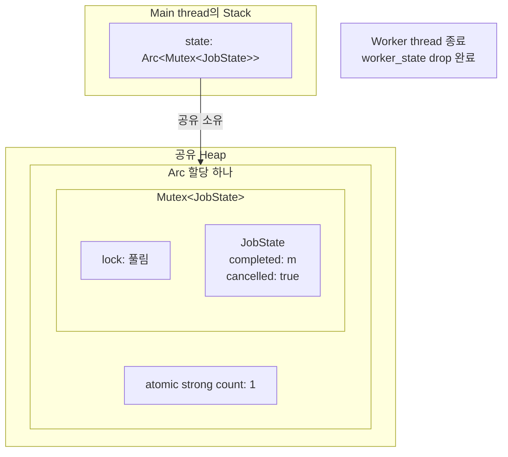

---
tags:
  - rust
  - memory
  - concurrency
created: 2026-10-20T13:17:31
updated: 2026-10-21T11:59:49
permalink: /Dev/rust/rust-thread-safe-smart-pointers-arc-and-mutex
description: "Arc·Mutex와 두 타입의 조합을 thread별 stack과 공유 메모리 도식으로 살펴보고, 공유 소유권·잠금·guard와 백그라운드 작업의 상태 공유를 설명한다."
---

> [!abstract]+ TL;DR
> - `Arc`의 atomic 참조 수를 이용한 thread 간 공유 소유권
> - `MutexGuard`의 수명으로 제한하는 내부 값의 배타적 접근
> - `Arc<Mutex<T>>`의 thread별 stack과 공유 heap 할당

> *AI-assisted*

---

### 1. Thread별 stack과 공유 heap

[[Rust Single Thread Smart Pointers - Rc and RefCell|Rc와 RefCell]]을 조합하면 같은 thread의 여러 소유자가 같은 값을 수정할 수 있다. 여러 thread에서도 이 관계를 만들려면 공유 소유권과 값의 변경을 각각 동기화해야 한다.

각 [OS thread](https://doc.rust-lang.org/std/thread/index.html#the-threading-model)는 자신의 stack과 지역 상태를 사용한다. 같은 프로세스의 heap 할당은 thread 사이에서 공유할 수 있으므로 서로 다른 stack의 포인터가 같은 값을 가리킬 수 있다.

- **공유 소유권**: 각 thread가 필요로 하는 동안 같은 값의 수명을 유지한다. `Rc`는 clone·drop 때 참조 수를 non-atomic 연산으로 바꾸므로 thread 사이에 공유할 수 없다.
- **공유 값의 변경**: 여러 thread가 같은 값을 수정할 때 접근을 동기화한다. `RefCell`의 borrow 검사는 thread 간 동기화를 제공하지 않는다.

`Arc`는 첫 요구를, `Mutex`는 두 번째 요구를 맡는다. 두 요구가 함께 있으면 `Arc<Mutex<T>>`를 쓴다.

> [!note]+ 도식: 메모리 관계의 개념 모형
> thread의 지역 값은 stack에 표시한다. 실제 ABI·최적화·OS별 lock 부가 자원은 생략하며 소유·빌림·값의 포함 관계를 나타낸다.

---

### 2. Arc: A thread-safe reference-counting pointer

> A thread-safe reference-counting pointer. ([Arc](https://doc.rust-lang.org/std/sync/struct.Arc.html))

`Arc<T>`는 heap의 같은 T를 여러 소유자가 함께 소유하는 포인터다. `Arc::clone`은 T를 복제하지 않고 같은 할당을 가리키는 Arc를 하나 더 만든다. 참조 수의 증감을 atomic 연산으로 처리하므로 여러 thread의 clone·drop이 겹쳐도 참조 수를 안전하게 관리한다.

다음 예제에서는 main과 worker가 같은 숫자 `10`을 읽는다.

```rust
use std::sync::Arc;
use std::thread;

fn main() {
    let number = Arc::new(10);
    let worker_number = Arc::clone(&number);

    let worker = thread::spawn(move || {
        assert_eq!(*worker_number, 10);
    });
    // 도식 시점 ①: spawn 반환 뒤 worker_number가 아직 살아 있는 가능한 시점

    assert_eq!(*number, 10);
    worker.join().unwrap();
    assert_eq!(Arc::strong_count(&number), 1);
}
```

시점 ①은 `spawn`이 반환된 뒤 worker가 아직 Arc를 보유한 가능한 실행 상태다. worker가 먼저 끝날 수도 있으므로 참조 수가 `1`이라는 검사는 `join()` 뒤에 둔다.



- **`move`**: `worker_number`의 소유권을 worker의 closure로 넘긴다. main에는 `number`와 종료 대기용 `worker`가 남는다.
- **같은 숫자**: 두 Arc가 같은 할당의 `10`을 읽는다. `Arc::clone`은 별도 숫자를 만들지 않는다.
- **종료 뒤**: worker의 Arc가 drop되면 `number`만 남아 strong count는 `1`이다. 마지막 Arc도 drop되면 내부 T가 drop된다.

주요 API는 [[Rust Single Thread Smart Pointers - Rc and RefCell#2.1 주요 method|Rc의 주요 method]]와 비슷하다. [[Rust Single Thread Smart Pointers - Rc and RefCell#2.5 get_mut과 make_mut|get_mut과 make_mut]]도 같은 소유권 원리로 동작한다. 여러 소유자가 있을 때 `make_mut`으로 값을 분리하면 다른 Arc는 기존 값을 계속 소유한다.

Arc가 동기화하는 대상은 **자신의 참조 수**다. 내부 T의 변경에는 T가 제공하는 동기화 API가 필요하며 일반적인 thread 간 Arc 공유 조건은 `T: Send + Sync`다.

---

### 3. Mutex: A mutual exclusion primitive

main과 worker가 같은 숫자를 각각 `1`씩 늘리려면 값을 읽고 더하고 쓰는 동안 다른 thread의 수정을 막아야 한다. 두 thread가 모두 `0`을 읽고 `1`을 쓰면 증가 하나가 누락된다. `Mutex<T>`는 lock을 얻은 thread 하나가 내부 T에 접근하도록 제한한다.

> A mutual exclusion primitive useful for protecting shared data ([Mutex](https://doc.rust-lang.org/std/sync/struct.Mutex.html))

#### 3.1 lock과 guard의 기본 동작

`lock()`이 성공하면 Mutex를 빌리는 [`MutexGuard<T>`](https://doc.rust-lang.org/std/sync/struct.MutexGuard.html)를 얻는다. guard로 내부 값을 읽거나 수정하고 guard가 drop될 때 unlock한다.

> When this structure is dropped (falls out of scope), the lock will be unlocked.

| 접근           | 다른 thread가 lock을 보유한 경우    | 반환과 해제                           |
| ------------ | -------------------------- | -------------------------------- |
| `lock()`     | 획득할 때까지 대기                 | 성공하면 guard, guard의 drop으로 unlock |
| `try_lock()` | 기다리지 않고 `WouldBlock` 오류 반환 | 획득에 성공하면 같은 guard                |

표준 `MutexGuard`는 `Send`가 아니므로 lock을 얻은 thread에서 해제한다. guard의 마지막 사용이 곧 drop은 아니어서 블록이나 `drop(guard)`로 lock 유지 범위를 정한다.

Mutex는 공유 소유권을 제공하지 않으며 [T를 자신의 필드에 담는다](https://doc.rust-lang.org/src/std/sync/poison/mutex.rs.html). `Mutex<i32>`의 숫자는 Mutex 안에 들어가고 Mutex를 지역 값으로 두면 그 숫자를 위한 별도 heap 할당은 필요하지 않다. `Arc` 안에 담으면 Mutex와 숫자가 함께 Arc의 heap 할당 안에 놓인다.

#### 3.2 두 thread의 공유 값 수정

main과 worker가 같은 `counter`를 공유하며 각각 `1`을 더하는 예제다.   

```rust
use std::sync::Mutex;
use std::thread;

fn main() {
    let counter = Mutex::new(0);

    thread::scope(|scope| {
	    // main thread
	    
        scope.spawn(|| {
	        // 이 본문만 새 worker thread에서 실행
            let mut worker_guard = counter.lock().unwrap();
            *worker_guard += 1;
        }); // worker 안에서 guard가 drop되며 unlock

        {
			// main thread
            let mut main_guard = counter.lock().unwrap();
            *main_guard += 1;
        } // main 안에서 guard가 drop되며 unlock
    }); // worker가 끝날 때까지 기다림

    assert_eq!(*counter.lock().unwrap(), 2);
}
```

`counter` 자체를 `move`로 worker에 넘기면 Mutex의 소유권도 worker로 이동하므로 main은 같은 Mutex에 접근할 수 없다. worker가 Mutex를 반환하도록 작성하면 main이 `join()`으로 소유권을 돌려받아 다시 사용할 수 있다. 이 경우에는 worker의 작업이 끝난 뒤 main이 같은 Mutex를 이어서 사용하는 순차적인 구조가 된다.

두 thread가 같은 Mutex를 함께 사용할 수 있도록 이 예제에서는 [`thread::scope`](https://doc.rust-lang.org/std/thread/fn.scope.html)를 사용한다.

- main은 `counter`의 소유권을 유지한 채 worker에 `&Mutex<i32>`를 빌려준다.
- `thread::scope`는 반환되기 전에 worker를 자동으로 join한다. worker는 `counter`가 drop되기 전에 작업을 마친다.
- 각 thread는 자기 안에서 `lock()`으로 guard를 얻어 값을 수정한다. guard가 drop될 때 잠금이 풀린다.

#### 3.3 lock의 반환값과 poisoning

예제의 `counter.lock().unwrap()`에서 [`lock()`](https://doc.rust-lang.org/std/sync/struct.Mutex.html#method.lock)은 `Result`를 반환한다. 이전 사용 중 발생한 panic 때문에 내부 값의 일관성을 확인해야 할 수 있기 때문이다.

- **정상 사용**: `Ok(guard)`로 값을 사용하고 guard가 drop되면 잠금이 풀린다.
- **panic으로 중단**: guard를 보유한 채 panic으로 scope를 빠져나가면 guard를 정리하면서 잠금을 풀고 **poisoned 상태**를 기록한다. 데이터 수정이 중간에 끊겼을 수 있다는 표시다.
- **이후 접근**: poisoned 상태에서는 다음 `lock()`이 잠금을 얻더라도 `Err(PoisonError)`를 반환해 데이터 확인이 필요함을 알린다.

예제의 `.unwrap()`은 이 오류를 다시 panic으로 처리한다. 복구가 필요하면 오류의 `into_inner()`로 guard를 꺼내 데이터를 확인·수정하고 [`clear_poison()`](https://doc.rust-lang.org/std/sync/struct.Mutex.html#method.clear_poison)으로 표시를 지울 수 있다.


---

### 4. `Arc<Mutex<T>>`: Thread-safe shared mutable state

백그라운드 파일 처리에서는 worker가 파일을 처리하는 동안 main이 진행 상태를 표시하고 취소 요청을 받는다. 작업을 시작하는 `start_job()`은 worker의 완료를 기다리지 않고 반환해야 한다. main은 그 뒤에도 다른 작업을 하면서 처리 개수를 읽거나 취소를 요청할 수 있어야 한다.

앞의 `thread::scope` 예제는 scope를 벗어나기 전에 worker의 종료를 기다렸다. 이 방식을 `start_job()` 안에 쓰면 main이 상태를 전달받을 때는 작업이 이미 끝나 있다. [`thread::spawn`](https://doc.rust-lang.org/std/thread/fn.spawn.html)으로 만든 worker는 자신을 시작한 함수보다 오래 실행될 수 있다.

> threads can outlive the lifetime they have been created in.

함수 반환 뒤에도 worker가 사용할 상태를 함수의 local variable에 대한 참조로 빌려줄 수는 없다. 다음 예제에서는 `Arc<Mutex<JobState>>`를 만들어 main과 worker가 같은 상태를 함께 소유한다.

- **Arc**: 같은 heap 할당을 가리키는 Arc를 main과 worker에 하나씩 준다. `start_job()`이 반환된 뒤에도 두 소유자가 각자 상태를 사용할 수 있다.
- **Mutex**: worker의 처리 개수 갱신과 main의 진행 상태 조회·취소 요청을 동기화한다. 여러 Arc가 같은 `JobState`를 공유하는 동안에는 `&mut JobState`를 얻을 수 없으므로 Mutex의 guard로 수정한다.

예제는 실제 파일 I/O 대신 `sleep()`으로 파일 하나의 처리 시간을 흉내 낸다. 파일 처리는 lock을 보유하지 않은 상태에서 수행하고 상태를 확인하거나 바꾸는 동안만 lock을 얻는다.

```rust
use std::sync::{Arc, Mutex};
use std::thread::{self, JoinHandle};
use std::time::Duration;

struct JobState {
    completed: usize,
    cancelled: bool,
}

fn start_job() -> (Arc<Mutex<JobState>>, JoinHandle<()>) {
    let state = Arc::new(Mutex::new(JobState {
        completed: 0,
        cancelled: false,
    }));
    let worker_state = Arc::clone(&state);

    let worker = thread::spawn(move || {
        for _ in 0..100 {
            if worker_state.lock().unwrap().cancelled {
                break;
            }

            // 파일 하나를 처리한다고 가정. 이 동안에는 lock을 보유하지 않는다.
            thread::sleep(Duration::from_millis(10));
            worker_state.lock().unwrap().completed += 1;
        }
    });

    (state, worker) // worker의 종료를 기다리지 않고 소유권을 호출자에게 반환
}

fn main() {
    let (state, worker) = start_job();

    {
        let snapshot = state.lock().unwrap();
        println!("처리한 파일: {}", snapshot.completed);
        // 도식 시점 ①: main이 lock을 보유하고 worker가 다음 lock을 기다리는 가능한 시점
    } // snapshot이 drop되며 unlock

    state.lock().unwrap().cancelled = true;
    worker.join().unwrap();
    // 도식 시점 ②: worker 종료 뒤, 아래 검사용 lock을 얻기 전

    assert!(state.lock().unwrap().cancelled);
    assert_eq!(Arc::strong_count(&state), 1);
}
```

`start_job()`의 `state`와 `worker`는 반환값으로 이동하고 `worker_state`는 worker의 closure로 이동한다. worker는 함수 안의 local variable을 빌리지 않으므로 함수가 반환된 뒤에도 실행할 수 있다. 출력되는 처리 개수는 두 thread의 실행 순서에 따라 달라진다.

시점 ①은 main이 `snapshot`을 보유하고 worker가 상태 확인이나 갱신을 위한 lock에서 기다리는 가능한 상태다. `n`은 이때까지 처리한 파일 개수다.



- **공유 소유권**
	- main과 worker의 Arc가 같은 Mutex와 `JobState` 하나를 소유
	- `snapshot`을 얻거나 drop해도 strong count는 바뀌지 않음
- **잠금 범위**
	- `snapshot`이 있는 동안 worker는 같은 Mutex의 lock을 얻을 수 없음
	- main은 이 guard를 먼저 drop한 뒤 새 임시 guard로 `cancelled`를 변경
- **취소 확인**
	- worker는 반복을 시작할 때 `cancelled`를 확인
	- 이미 시작한 파일 처리는 끝날 수 있으며 취소 요청을 확인하면 다음 파일을 처리하지 않고 종료

시점 ②에서는 `join()`으로 worker의 종료를 확인했다. worker의 Arc가 drop되어 main의 Arc만 남고 `m`은 최종 처리 개수다.



- **남은 소유자**
	- `join()`은 `worker`를 소비하므로 main의 Stack에는 JoinHandle이 남지 않고  상태는 main의 `state`가 계속 소유
- **반납 시점**
	- worker가 끝나도 main은 상태를 읽을 수 있음
	- 마지막 Arc가 drop될 때 Mutex와 내부 `JobState`가 drop

---

### 5. 타입 선택과 thread 공유 조건

| 타입              | 공유 소유권 | 내부 T의 위치           | 수정 경로                          | thread 간 공유 조건   |
| --------------- | ------ | ------------------ | ------------------------------ | ---------------- |
| `Arc<T>`        | 제공     | Arc의 heap 할당 안     | get_mut·make_mut 또는 T의 동기화 API | `T: Send + Sync` |
| `Mutex<T>`      | 제공 안 함 | Mutex 자신의 필드       | lock·try_lock의 guard           | `T: Send`        |
| `Arc<Mutex<T>>` | 제공     | Arc 할당 안의 Mutex 필드 | Mutex의 guard                   | `T: Send`        |

- [`Send`](https://doc.rust-lang.org/std/marker/trait.Send.html)는 값의 소유권을 다른 thread로 넘겨도 안전함을 나타낸다.
- [`Sync`](https://doc.rust-lang.org/std/marker/trait.Sync.html)는 공유 참조 `&T`를 thread 사이에 넘겨도 안전함을 나타낸다. `T: Sync`의 정의는 `&T: Send`다.

`Mutex<T>`는 `T: Send`이면 `Send`와 `Sync`를 구현한다. guard로 T를 교체해 꺼내는 thread가 달라질 수 있으므로 T는 thread 사이에서 이동할 수 있어야 한다. lock을 얻은 thread에 차례로 배타적 접근을 제공하므로 T 자체의 `Sync`는 요구하지 않는다.

Arc 안의 타입이 `Mutex<T>`일 때는 `T: Send`만으로 Mutex가 `Send + Sync`를 만족하므로 Arc의 공유 조건도 충족한다.

| 필요한 동작                                  | 선택할 수 있는 타입       |
| --------------------------------------- | ----------------- |
| 여러 thread가 같은 데이터를 소유하며 읽기              | `Arc<T>`          |
| 수명을 다른 방식으로 확보한 값에 여러 thread가 lock으로 접근 | `Mutex<T>`와 공유 참조 |
| 여러 thread가 같은 값을 소유하며 lock으로 수정         | `Arc<Mutex<T>>`   |

`Arc<RefCell<T>>`는 `RefCell<T>`가 `Sync`가 아니므로 thread 간 공유에 쓸 수 없다. `Arc<Mutex<Rc<T>>>`도 내부 Rc가 `Send`가 아니어서 조건을 만족하지 않는다. RefCell은 T가 Send이면 소유권을 다른 thread로 옮길 수 있지만 같은 RefCell을 여러 thread가 공유하도록 동기화하지는 않는다.

값의 수명을 빌림으로 표현할 수 있으면 공유 소유권을 추가할 필요가 없다. 같은 thread 안에서 소유권과 가변 접근을 조합할 때는 [[Rust Single Thread Smart Pointers - Rc and RefCell|Rc와 RefCell]]을 사용할 수 있다.
